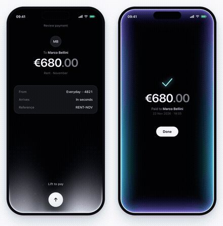

# `sdf-edge-aurora-ui`

[](./LICENSE)
[](./SKILL.md)
[-111111)](./examples)

<div align="center">



*Rendered live from our clean-room WebGL2 [`examples/web/demo.html`](./examples/web/demo.html) across all 4 verified palettes (**Pearl Silver**, **Ocean Blue**, **Sunset Coral**, **Aurora Mint**) and interactive **Lift-to-Pay** states.*

</div>

An **Antigravity Skill** and verified cross-platform reference implementation for building a **60/120fps Single-Pass SDF Inner Screen-Edge Aurora Glow** in **WebGL2 / React (+ CSS `@property` fallback)** and **SwiftUI `[[stitchable]]` Metal `.colorEffect` (macOS 14+ & iOS 17+, Swift 6)**.

Instead of chaining costly multi-pass blurs, a single fragment shader analytically evaluates a crease-free `p = 2` smooth rounded-box SDF, universal dual-exponential falloff (`σ₂ = 0.075 W`, `σ₁ = 0.014 W`, `coreHot = 0.005 W`), linear-HDR filmic white-shoulder tone-mapping (`1 - exp(-hdr)`), void-gated 1-LSB TPDF dark-end dithering, top-edge Dynamic Island attenuation, and 7-state **Lift-to-Pay** volumetric FBM curtain + twin mirror-symmetric comet choreography.

> **Attribution & Clean-Room Scope:** Inspired by `@sucodeee`'s MetalForge **Tide Send** showcase ([`metalforge.xyz/tidesend`](https://metalforge.xyz/tidesend), [X post `2124564089527578859`](https://x.com/sucodeee/status/2124564089527578859), design credit `@suriadesign`). `Tide Send` is a commercial MetalForge component; this skill, its optical specification, and all bundled WebGL2/React and SwiftUI/Metal implementations are independent **clean-room reconstructions** derived from FFmpeg pixel/kymograph analysis of the public `924×1440` @ 30fps showcase video.

---

## Four Verified Palettes (Default: Pearl Silver)

All 4 palettes share identical SDF geometry (`R = 0.154 W`), universal wide veil width (`σ₂ = 0.075 W`), `0.0000 DN` bilateral symmetry, and 7-state choreography. **Pearl Silver is the recommended default.**

| Palette | Character & Optical Signature | Lower Accent (`colA`) | Mid Band (`colB`) | Top Crown (`colC`) | Checkmark `✓` |
| :--- | :--- | :--- | :--- | :--- | :--- |
| **Pearl Silver** (`pearl` / `.pearl`) — **Default** | Cool platinum-white rim (`#FFFFFF`/`#FAF8FE`) with ice-blue (`215–225°`) & pearl-lavender (`245–252°`) aura — never flat gray | `#B3C7DE` / `#BED5F2` | `#CCC7DE` / `#D9D0F1` | `#99A6BF` / `#909CBB` | `#FFFFFF` |
| **Ocean Blue** (`ocean` / `.ocean`) | Electric cyan base surge, cobalt mid-wall, deep indigo-violet crown | `#38D1FC` / `#2EDAFD` | `#6E8FF5` / `#5C80F5` | `#7D6EF2` / `#745BEC` | `#87E8F4` |
| **Sunset Coral** (`sunset` / `.sunset`) | Warm amber-gold base, luminous salmon-coral mid-wall, deep rose-magenta crown | `#FCAB5C` / `#FFB857` | `#F57A70` / `#F56B6C` | `#E63D8F` / `#E03D94` | `#F3D38C` |
| **Aurora Mint** (`aurora` / `.aurora`) | Electric ice-mint base, seafoam emerald mid-wall, deep jade-teal crown | `#47F7E6` / `#57FBE6` | `#61E8BD` / `#37E0B3` | `#1FB894` / `#1BAC88` | `#89F5DB` |

---

## Verified Cross-Platform Metrics

Independently audited across headless Chrome CDP (`ANGLE/Metal`, `DPR = 2`), Node React SSR, `tsc --strict`, `xcrun metal -Wall -Wextra -Werror` (`macosx` + `iphonesimulator`), Swift 6 `-warnings-as-errors` (`macOS 14+` + `iOS 17+ Simulator`), and Apple Silicon GPU execution (`32/32` assertions):

| Verification Metric | Reference Video (`f850`) | WebGL2 + React | SwiftUI + Metal |
| :--- | ---: | ---: | ---: |
| **Performance / Draw Cost** | `30 fps` source | **`60.65 FPS` · `0.108 ms` avg draw** | Single-pass `[[stitchable]]` (`32/32` GPU PASS) |
| **Pearl Silver Falloff (`d₅₀ / d₂₅ / d₁₀`)** | `15 / 38 / 70 px` | `13 / 37 / 65 px` | `16 / 41 / 70 px` |
| **Center OLED Void / Dark-End Residual** | `0.00 DN` / `0.449 DN` | `0.00 DN` / `0.292 DN` | `0.00 DN` / `0.470 DN` |
| **Bilateral Symmetry (`\|L - mirror(R)\|`)** | `0.621 DN` | `0.208 DN` | **`0.0000 DN`** (all 4 palettes & comets) |
| **45° Corner Medial-Axis Crease Mitigation** | `~5.0 DN` (IQ exact) | **`-35%`** (`p=2` smooth SDF) | **`-64%`** (`p=2` smooth SDF) |
| **SwiftUI `.colorEffect` vs. Compute Parity** | — | — | **`0.021 DN`** (`ImageRenderer` verified) |

---

## Quick Preview (Zero Build)

Open the standalone interactive WebGL2 & CSS `@property` playground directly in your browser or via a local static server:

```bash
# macOS quick open
open examples/web/demo.html

# Or serve locally
python3 -m http.server 8000
# Visit http://localhost:8000/examples/web/demo.html
```

Useful URL flags for visual inspection and deterministic testing:
- `?palette=pearl` (default), `ocean`, `sunset`, or `aurora`
- `?phase=idle` | `drag` | `release` | `sending` | `success` | `dismiss` (pair with `&drag=0.96` or `&t=1.55`)
- `?phone-only=1` — hide studio controls for clean bezel-only capture
- `?renderer=css` — preview the CSS `@property` fallback tier
- `?smooth=0` — compare exact Inigo Quilez `sdRoundedBox` vs. `p=2` smooth interior SDF
- `?reduced-motion=1` — preview static reduced-motion mode

---

## Installation (Antigravity Skill)

Clone directly into your **workspace skills directory** (project-scoped, recommended for team repos) or your **global skills directory** (available across all workspaces):

### Workspace Install (Project-Specific)

```bash
mkdir -p .agents/skills
git clone https://github.com/Rea1Felix/sdf-edge-aurora-ui.git .agents/skills/sdf-edge-aurora-ui
```

### Global Install (Machine-Local)

```bash
mkdir -p ~/.gemini/config/skills
git clone https://github.com/Rea1Felix/sdf-edge-aurora-ui.git ~/.gemini/config/skills/sdf-edge-aurora-ui
```

Because `SKILL.md` sits at the repository root and matches the folder name `sdf-edge-aurora-ui`, Antigravity discovers it automatically on the next turn without extra setup.

---

## Repository Structure

```text
sdf-edge-aurora-ui/
├── SKILL.md                                  # Antigravity skill entrypoint, workflow & 9 verified pitfalls
├── assets/
│   └── preview.gif                           # Live clean-room WebGL2 preview rendered from examples/web/demo.html
├── references/
│   ├── optical-sdf-spec.md                   # 506×1100 geometry, dual-exp falloff, 4-palette tables, SDF/perim math & 7-state kinematics
│   └── platform-pitfalls.md                  # WebGL2/React + CSS fallback, SwiftUI Metal color-space parity, EDR & a11y checklists
├── examples/
│   ├── web/
│   │   ├── SdfEdgeAurora.tsx                 # Production React + WebGL2 + CSS @property fallback component (SSR-safe)
│   │   └── demo.html                         # Zero-build interactive Lift-to-Pay & 4-palette WebGL2/CSS playground
│   └── swiftui/
│       ├── TideEdgeAurora.metal              # Single-pass [[stitchable]] SwiftUI Metal .colorEffect & compute kernel
│       └── SdfEdgeAuroraView.swift           # Production Swift 6 SwiftUI EdgeAuroraBackdrop, controller & showcase
├── scripts/
│   └── verify_skill_examples.sh              # Automated frontmatter, link, Metal, Swift 6, TypeScript & demo.html verifier
├── LICENSE                                   # MIT License
└── README.md
```

Key documentation links:
- [Skill Entrypoint (`SKILL.md`)](./SKILL.md)
- [Optical, Geometry & Kinematic Specification](./references/optical-sdf-spec.md)
- [Platform Implementation, Color Space & Accessibility Pitfalls](./references/platform-pitfalls.md)
- [React + WebGL2 Component (`SdfEdgeAurora.tsx`)](./examples/web/SdfEdgeAurora.tsx)
- [Interactive WebGL2 Playground (`demo.html`)](./examples/web/demo.html)
- [SwiftUI Metal Shader (`TideEdgeAurora.metal`)](./examples/swiftui/TideEdgeAurora.metal)
- [SwiftUI Swift 6 Component (`SdfEdgeAuroraView.swift`)](./examples/swiftui/SdfEdgeAuroraView.swift)

---

## Verification

Run the bundled validation script from the repository root:

```bash
./scripts/verify_skill_examples.sh
```

The script validates:
1. `SKILL.md` YAML frontmatter (`name: sdf-edge-aurora-ui`), all relative Markdown links across `SKILL.md`, `README.md`, and `references/` (including `./assets/preview.gif`), and zero leaked local/ephemeral workspace paths or UUIDs.
2. Metal shader compilation (`xcrun metal -Wall -Wextra -Werror`) on `examples/swiftui/TideEdgeAurora.metal` for both **macOS** (`macosx`) and **iOS Simulator** (`iphonesimulator`) when Xcode Metal tools are installed.
3. Swift 6 strict typechecking (`-swift-version 6 -warnings-as-errors -parse-as-library -typecheck`) on `examples/swiftui/SdfEdgeAuroraView.swift` for both **macOS 14+ (`arm64-apple-macosx14.0`)** and **iOS 17+ Simulator (`arm64-apple-ios17.0-simulator`)**.
4. Strict TypeScript checking (`--strict --noUnusedLocals --noUnusedParameters --noEmit`) on `examples/web/SdfEdgeAurora.tsx` when `tsc` and `@types/react` are available.
5. Structural accessibility/debug markers and inline JavaScript syntax (`node --check`) on `examples/web/demo.html`.

---

## License

MIT License — Copyright (c) 2026 [Rea1Felix](https://github.com/Rea1Felix). See [LICENSE](./LICENSE).
